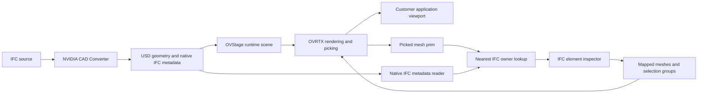

# IFC viewer building blocks

An agent-readable reference for integrating IFC inspection and RTX rendering into a customer application. This is a guide to existing components, not a new viewer framework or an installable skill. Start with the host application's architecture and reuse the components below.

## Component map

| Capability | Source | How to use it |
|---|---|---|
| RTX viewer foundation | [NVIDIA Omniverse Realtime Viewer skill](https://github.com/NVIDIA/skills/blob/main/skills/omniverse-realtime-viewer/SKILL.md) | Use its application recipes, dependency guidance, OVStage scene ownership, OVRTX rendering, delivery and validation guidance. |
| Renderer integrated into an existing application | [Omniverse Blender example 0.2](https://github.com/NVIDIA-Omniverse/omniverse-labs/releases/tag/ovrtx-blender-example-0.2), [architecture](https://github.com/NVIDIA-Omniverse/omniverse-labs/blob/main/projects/ov-blender-example/docs/architecture.md), [developer guide](https://github.com/NVIDIA-Omniverse/omniverse-labs/blob/main/projects/ov-blender-example/docs/developer-guide.md) | Study host/runtime separation, scene updates and viewport lifetime. This is a reference integration, not a Nemetschek plugin. |
| Walkthrough | [Omniverse Libraries Playground](https://github.com/NVIDIA-Omniverse/omniverse-labs/tree/main/samples/ov-library-playground-sample), especially [navigation.py](https://github.com/NVIDIA-Omniverse/omniverse-labs/blob/main/samples/ov-library-playground-sample/source/nvidia/ov_library_lab/navigation.py) | Reuse the walking-controller approach. Adapt floor/obstacle information, units, up-axis and entry positions to the imported building. Test stairs and level changes separately. |
| Orbit, fly, focus and picking | Viewer skill: [camera controls](https://github.com/NVIDIA/skills/blob/main/skills/omniverse-realtime-viewer/references/camera-controls/README.md), [native picking and selection](https://github.com/NVIDIA/skills/blob/main/skills/omniverse-realtime-viewer/references/native-picking-selection/README.md) | Use existing renderer interaction rather than implementing a second camera or picking system. |
| IFC element inspection | Published [ifc_inspection.py](https://github.com/chrismcleodnvidia/rtx-scan-planning/blob/v0.7.0.5/runtime/ifc_inspection.py) and its dependency [native_ifc.py](https://github.com/chrismcleodnvidia/rtx-scan-planning/blob/v0.7.0.5/runtime/native_ifc.py) | Resolve picked meshes to IFC owners and read existing native CAD USD metadata. These helpers can be used without Isaac Sim or running scans. |
| Colour by IFC class and two-way selection | IFC helpers above plus OVRTX selection-group APIs; see the recipe below | Map renderable meshes to IFC classes, supply a legend and highlight selected elements. This is application glue around existing renderer functionality. |
| Generic scene rendering | [OVRTX](https://github.com/NVIDIA-Omniverse/ovrtx) and its [skills](https://github.com/NVIDIA-Omniverse/ovrtx/tree/main/skills) | Follow the selected release's requirements for lighting, materials, rendering and image output. |
| Optional scan inspection | Separate [RTX scan planning skill](https://github.com/chrismcleodnvidia/rtx-scan-planning) and [visualization guide](https://github.com/chrismcleodnvidia/rtx-scan-planning/blob/main/references/visualization.md) | Use only when recorded scans are part of the application. Planning, capture, coverage, point previews and full-capture inspection images remain in that package. |

Upstream main-branch links evolve. Record the versions used by the application and follow their matching API and platform documentation. The helper links are pinned to v0.7.0.5 for reproducibility; no vendor code or SDK is bundled here.

## Data flow



An existing USD exporter can supply the USD instead. The supplied identity reader specifically understands NVIDIA CAD Converter metadata; another exporter may require a different reader. Inspection reads the exported IFC properties directly from USD.

## IFC inspector: reusable lookup, host-owned UI

The published helper is not a complete inspector widget. Its reusable functions are:

| Function | Purpose |
|---|---|
| `nearest_owner(prim_path, elements)` | Resolve a picked mesh or child prim to its nearest IFC owner. |
| `mesh_index(stage, elements)` | Build the reverse mapping needed to select or colour all meshes belonging to an IFC element. Nested IFC owners remain distinct. |
| `scan_owner(labels, index, elements)` | Optionally resolve a recorded scan point's label to the matching IFC identity. |

Read metadata once per USD revision using `native_ifc.metadata()`. Cache the mesh ownership index in memory; invalidate it when scene identity or hierarchy changes. The helper CLI needs Python and OpenUSD (`pxr`), not Isaac Sim. The host RTX renderer has its own upstream requirements.

Example, with both helper files in the same directory and OpenUSD available:

```bash
python ifc_inspection.py --usd building.usdc --prim /Asset/Wall/Shape
python ifc_inspection.py --usd building.usdc --mesh-index --output mesh-owners.json
```

Replace the example prim path with an actual picked path. The optional JSON index is a rebuildable cache, not required BIM authority. The reader exposes the native metadata it recognises; this is not a claim to preserve every possible IFC property or relationship.

The application should display the selected element's identity, class, name and available properties beside the viewport. Selection works both ways: viewport pick updates the inspector; inspector selection highlights the mapped renderable meshes. A search/list can share the same selected identity. Keep this independent of scan capture.

## Colour and visibility recipe

The reference workbench used one mutually exclusive appearance selector:

- **Materials:** normal material rendering.
- **White:** renderer white-material override.
- **Colour by IFC class:** neutral base with a distinct group fill for each IFC class.

Class colours represent categories such as `IfcWall` and `IfcWindow`, not unique colours for every object. A legend lists the classes present, their colours and element counts. Selecting an individual element adds a distinct selection highlight; it must not destroy the category-colour state.

Implementation details verified in the workbench:

1. Resolve each renderable mesh to its IFC owner, then group mesh paths by `ifc_class`. Applying groups only to parent Xforms does not reliably colour their rendered geometry.
2. Configure OVRTX `SelectionFillMode.GROUP_FILL_COLOR`, assign `SelectionGroupStyle` colours, and apply groups to the renderable paths. Check the exact API in the installed renderer version.
3. Use a deterministic class-to-colour mapping shared by viewport and legend. The workbench used a SHA-256-derived hue with fixed saturation/value; this is a convention, not an IFC standard. Retain text labels because colour alone is insufficient.
4. Keep selected-element styling separate and restore class grouping after deselection. The workbench combined class fills with the renderer's white override to prevent source materials obscuring the colours.
5. For walls, ceilings, roofs or individual elements, change visibility on the live stage. Keep these presentation changes separate from the supplied asset; avoid re-exporting or reloading it for each toggle.

These are recipes based on the reference application. The public helper provides ownership mappings; it does not ship the workbench's UI, colour controls or a ready-made host plugin.

## Walkthrough and host integration

Use the Playground specifically for walking, and the official Viewer skill for the surrounding viewer. A fixed-height free camera is not collision-aware walking. The Playground's campus layout and Y-up assumptions need adaptation for arbitrary IFC scenes; a controller working on one floor does not establish building-wide navigation.

The Blender example illustrates how an existing authoring application can integrate RTX. Preserve host identities, serialize scene updates through the runtime owner, and separate scene lifetime from viewport panes. Choose native frame presentation or streaming to suit the host; the browser-streamed reference workbench is only one implementation.

## Usability and performance patterns worth retaining

- Put the selected-element inspector alongside the viewport and consolidate view, appearance and visibility controls.
- Keep model loading explicit. Do not show a full loading overlay for a visibility toggle, camera move or selection.
- Reuse the loaded stage and metadata/ownership caches. Apply small changes incrementally.
- Make camera input focus predictable after clicking menus or entering the building. Provide focus-selection and reset-view actions.
- If scans are enabled, preload or asynchronously prepare their display data. Clearly distinguish reduced recorded-point previews, coverage diagnostics and scanner-position markers.

## Integration check and validation scope

First validate a loaded USD, a rendered frame, camera movement, a pick that resolves to IFC properties, inspector-to-viewport selection, three appearance modes and visibility toggles. Then switch models and verify stale identities/caches are discarded. Validate the walkthrough against actual floors and obstacles and test viewport close/reopen and runtime recovery in the target application.

The IFC lookup helpers have focused automated tests. The inspection, class colouring and incremental presentation patterns were exercised in the custom browser-streamed workbench. RTX embedding in the customer's application, and adaptation of the Playground walkthrough to their models, remain integration work. Blender example 0.2 is an upstream reference, not a customer integration tested by this project.

## Package boundary

This document collects viewer references and reusable integration patterns. It is intentionally separate from the [RTX scan planning skill](https://github.com/chrismcleodnvidia/rtx-scan-planning), which retains scanner placement, captures, coverage refinement, scan-point labels, preview generation and full-capture inspection images. Shared IFC lookup helpers stay linked to one published implementation rather than being copied into a second codebase.
